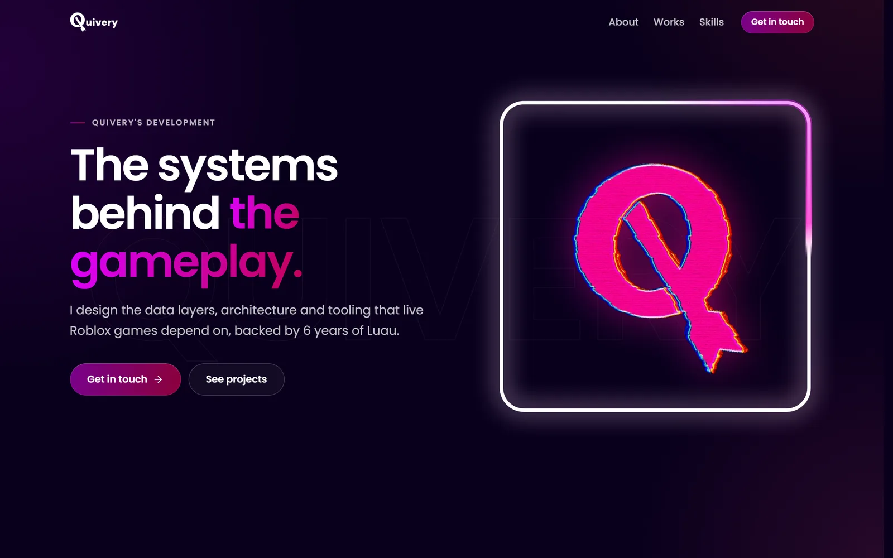
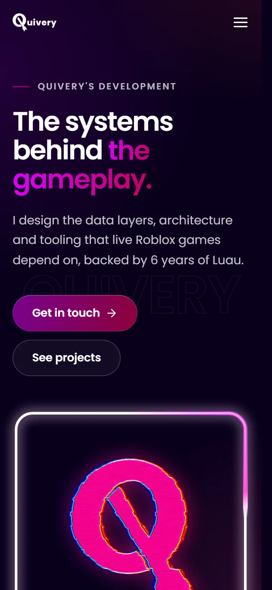
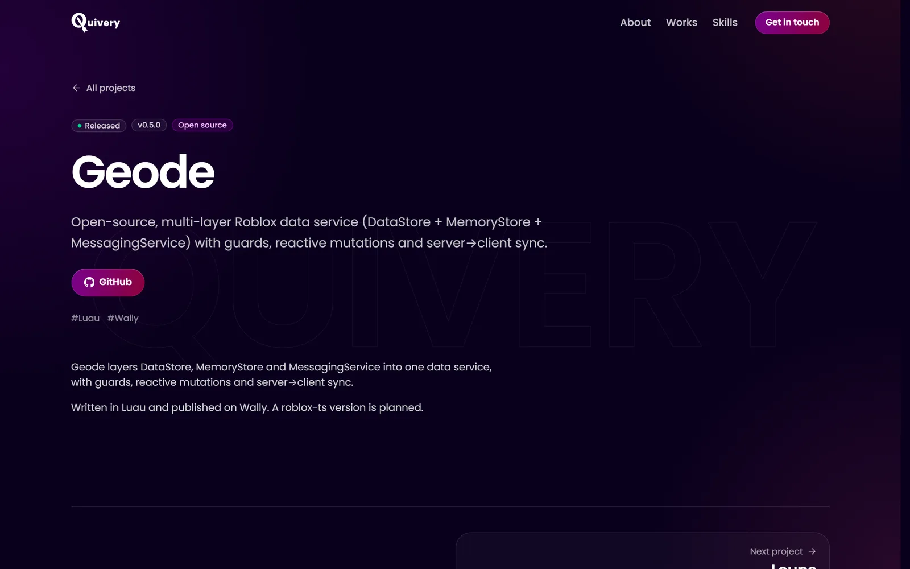
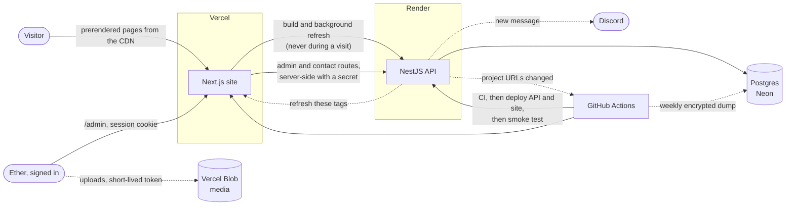
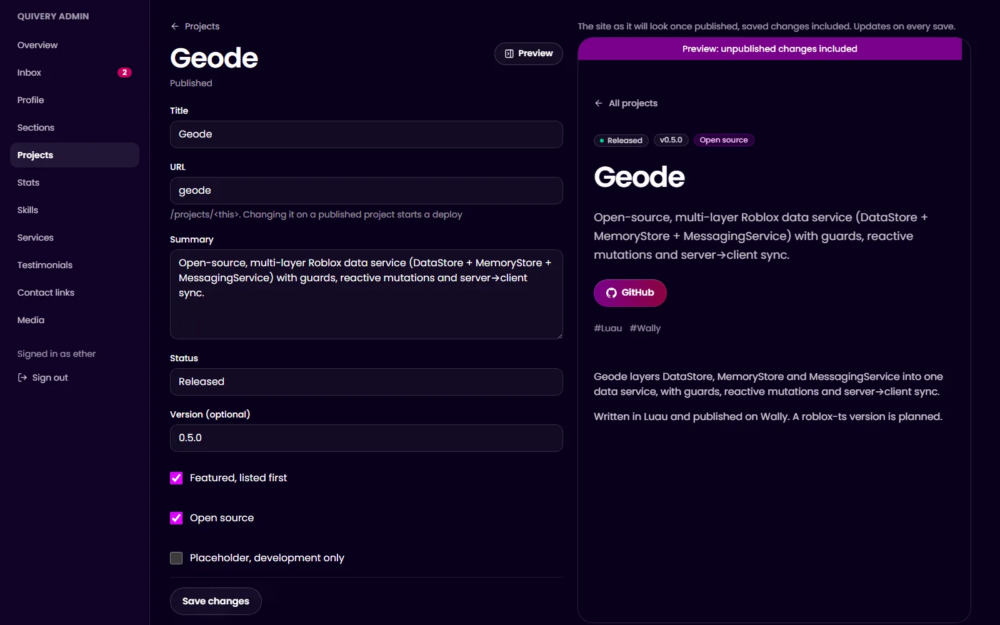

# Quivery Portfolio

The portfolio of **Ether (Quivery)**, a Roblox systems engineer with 6 years of Luau, working on data layers, architecture and tooling for live games.

**Live: https://quivery-portfolio.vercel.app**



<p>
  
  
</p>

It isn't a static page. A NestJS API owns the content in Postgres, an admin panel edits it, and a Next.js site prerenders every public page from it. Pages are served from cache and refreshed by tag when content changes, so visitors never wait on the API, even when it's asleep.

## What it shows

- **Full-stack TypeScript in one monorepo:** a Next.js 16 site, a NestJS 12 API and one package of Zod schemas that both sides validate against, so a content shape is defined exactly once
- **A real CMS, built from scratch:** server-side sessions, rate-limited sign-in, strict schemas on every write, draft copies of published items, a live preview, media uploads straight to object storage, and a deploy started automatically when a project URL changes
- **Production habits on free tiers:** CI gates every deploy (secret scan, lint, types, unit, end-to-end and database tests, an accessibility check, a production build, a Docker smoke test), then the API, the site and a smoke test of the live result. A weekly database dump is encrypted before it leaves the runner
- **Security by default:** a Content-Security-Policy that works with static pages, HSTS, frame protection, an admin that the API keeps closed whatever the URL, and secrets that never touch the repo or a terminal
- **Accessible and fast:** WCAG 2.2 AA checked by axe in CI, keyboard and screen-reader friendly, reduced motion respected, and Lighthouse mobile 98 for performance and 100 for the rest (see Quality)

## Stack

| Layer   | Technology                                                                    |
| ------- | ----------------------------------------------------------------------------- |
| Site    | Next.js 16 (App Router, Cache Components), React 19, Tailwind CSS 4           |
| API     | NestJS 12, Prisma 7, PostgreSQL                                               |
| Shared  | Zod 4 schemas for every request, response and content block                   |
| Tooling | TypeScript, Turborepo, npm workspaces, Vitest, Playwright, axe, ESLint        |
| Hosting | Vercel (site, media), Render (API, Docker), Neon (Postgres), all in Frankfurt |
| CI/CD   | GitHub Actions: checks on every change, then deploy and smoke test            |

## Architecture



- **One source of truth for data shapes:** `packages/shared` holds the Zod schemas for the content model, the API envelope and every content block. The API validates writes with them and the site validates every response
- **Static by construction:** the public layout sets `ensureStatic = 'navigation'`, so the build fails if a public page would render per request. Reads are cached with `'use cache'` and tagged `site`, `projects` or `project:<slug>`, and share cards and the sitemap are prerendered the same way
- **Fails safe:** a failed refresh keeps the last good page. A build that can't reach the API, or gets an empty homepage, fails, and the host keeps the previous deployment live
- **Content without migrations:** the homepage is an ordered list of sections. Typed sections render their models (projects, skills...) and custom sections render JSON blocks (rich text, images, video, galleries, embeds, code) from a Zod discriminated union
- **Built for a sleeping free tier:** the API scales to zero when idle. Builds wake it first, and the database is only touched by builds, refreshes, the admin and the contact form
- **Contact form that never loses a message:** stored before anything else, retried with an idempotency key, the draft kept in the browser until the API confirms it. Spam is filtered with a hidden field, a time check, link and rate limits, and new messages are announced on Discord
- **Found and shared properly:** generated Open Graph cards per page, a sitemap, canonical URLs, and schema.org data (a Person for Ether, SoftwareSourceCode for open-source projects)
- **Self-hosted fonts:** Poppins subset to what the content uses, with the arrows it lacks merged in from Inter, so no visitor's browser ever goes looking for a fallback



## Quality

| Lighthouse (mobile, live) | Performance | Accessibility | Best practices | SEO |
| ------------------------- | ----------- | ------------- | -------------- | --- |
| Homepage                  | 98          | 100           | 100            | 100 |
| Geode                     | 98          | 100           | 100            | 100 |
| Loupe                     | 98          | 100           | 100            | 100 |

Median of three runs each, October 2026. Every page has a cumulative layout shift of 0 to 0.013.

- **Tests:** 49 schema tests, 59 API unit tests, 22 API end-to-end tests and 14 admin tests against a real Postgres, all in CI
- **Accessibility:** axe finds nothing at WCAG 2.2 AA on the homepage, a project page and the admin sign-in, at phone and desktop widths and with the phone menu open, on every build
- **After every deploy:** 13 smoke checks against the live site and API, from security headers and share cards to the admin staying closed

## Repository

| Path                         | What it is                                         |
| ---------------------------- | -------------------------------------------------- |
| `apps/web`                   | The Next.js site and the admin                     |
| `apps/backend`               | The NestJS API, Prisma schema, migrations and seed |
| `packages/shared`            | Zod schemas and types both apps use                |
| `packages/eslint-config`     | Shared ESLint configs                              |
| `packages/typescript-config` | Shared `tsconfig` bases                            |
| `scripts/deploy`             | Deploy, smoke test and revalidation scripts        |
| `.github/workflows`          | CI, deploys, backups, keepalive and the seed       |

## Run it locally

You need Node 24+, npm 11 and Docker Desktop running.

```sh
npm install
cp apps/backend/.env.example apps/backend/.env
cp apps/web/.env.example apps/web/.env.local
npm run db:up
npm run db:migrate
npm run db:seed
npm run dev
```

The site runs on http://localhost:3000 and the API on http://localhost:5005. [CONTRIBUTING.md](CONTRIBUTING.md) covers the rest: scripts, editing content, the admin, testing on a phone, code style and commits. [DEPLOY.md](DEPLOY.md) covers production, and [MAINTENANCE.md](MAINTENANCE.md) what expires, what runs on a schedule and how to rotate secrets.
