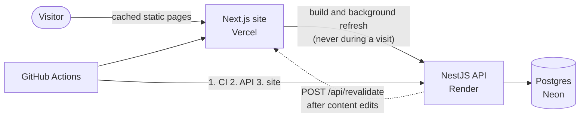

# Quivery Portfolio

The portfolio of **Ether (Quivery)**, a Roblox systems engineer with 6 years of Luau, working on data layers, architecture and tooling for live games.

**Live:** LIVE_SITE_URL

It isn't a static page. A NestJS API owns the content in Postgres, and a Next.js site prerenders every public page from it. Pages are served from cache and refreshed by tag when content changes, so visitors never wait on the API, even when it's asleep or down.

## Stack

| Layer   | Technology                                                                 |
| ------- | -------------------------------------------------------------------------- |
| Site    | Next.js 16 (App Router, Cache Components), React 19, Tailwind CSS 4        |
| API     | NestJS 12, Prisma 7, PostgreSQL                                            |
| Shared  | Zod 4 schemas for every request, response and content block                |
| Tooling | TypeScript, Turborepo, npm workspaces, Vitest, ESLint, oxlint, Prettier    |
| Hosting | Vercel (site), Render (API, Docker), Neon (Postgres), all in Frankfurt     |
| CI/CD   | GitHub Actions: lint, types, tests and builds on every change, then deploy |

## How it works



- **One source of truth for data shapes:** `packages/shared` holds the Zod schemas for the content model, the API envelope and every content block. The API validates writes with them and the site validates every response
- **Static by construction:** the public layout sets `ensureStatic = 'navigation'`, so the build fails if a public page would render per request. Reads are cached with `'use cache'` and tagged `site`, `projects` or `project:<slug>`
- **Fails safe:** a failed refresh keeps the last good page. A build that can't reach the API, or gets an empty homepage, fails, and the host keeps the previous deployment live
- **Content without migrations:** the homepage is an ordered list of sections. Typed sections render their models (projects, skills...) and custom sections render JSON blocks (rich text, images, video, galleries, embeds, code) from a Zod discriminated union. Types the site doesn't know yet are skipped, not crashed on
- **Built for a sleeping free tier:** the API scales to zero when idle. Builds wake it first, and the database is only touched by builds, refreshes and the contact form
- **Media:** images go through `next/image`, and videos and embeds show a poster and load nothing until clicked

Coming next: a contact form, then an admin panel for the content (drafts, ordering, live preview), then SEO, accessibility and performance polish.

## Repository

| Path                         | What it is                                         |
| ---------------------------- | -------------------------------------------------- |
| `apps/web`                   | The Next.js site                                   |
| `apps/backend`               | The NestJS API, Prisma schema, migrations and seed |
| `packages/shared`            | Zod schemas and types both apps use                |
| `packages/eslint-config`     | Shared ESLint configs                              |
| `packages/typescript-config` | Shared `tsconfig` bases                            |
| `scripts/deploy`             | Deploy, smoke test and revalidation scripts        |
| `.github/workflows`          | CI, deploys and the manual production seed         |

## Run it locally

You need Node 24+, npm 11 and Docker Desktop running.

```sh
npm install
cp apps/backend/.env.example apps/backend/.env
cp apps/web/.env.example apps/web/.env.local
npm run db:up
npm run db:migrate
npm run db:seed
npm run dev
```

The site runs on http://localhost:3000 and the API on http://localhost:5005. [CONTRIBUTING.md](CONTRIBUTING.md) covers the rest: scripts, editing content, testing on a phone, code style and commits. [DEPLOY.md](DEPLOY.md) covers production.
